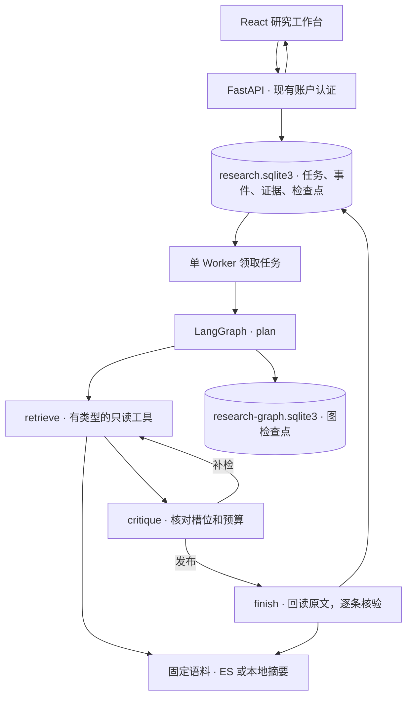

# ScholarLens EvoResearch 运行架构

本地研究工作台从 `zjl` 的 `3e130b0` 建立。用户在 `/research` 提交问题、研究深度和论文范围，服务端在一个 Worker 中执行分轮检索。每条报告结论都带有支持状态，读者可以展开所属子任务，核对原文与实验条件。[本地启动与操作](USER_GUIDE.md) · [原系统基线](BASELINE_AUDIT.md)

## 应用、状态与恢复

正常应用在 `SCHOLARLENS_RESEARCH_ENABLED=true` 时挂载 `/api/research` 并绑定账户、存储与检索语料。前端构建开关为 `VITE_RESEARCH_ENABLED=true`。两者默认关闭。独立演示以回环 HTTP 运行同一研究 API 和执行器，可选择两篇合成材料或 12 篇锁定的公开种子论文。正式应用的本机验收使用 Elasticsearch。[正式入口](../../backend/app1.py) · [后端开关](../../backend/research/flags.py) · [独立演示](../../tools/research_demo.py)

创建请求带幂等键并返回 HTTP 202。任务、事件、证据和应用检查点由同一用户与任务 ID 定位。修改任务时，代码核对修订号并以事务提交状态和事件。浏览器用 `after_seq` 补拉断线后的事件，暂停与取消等到 Worker 确认才显示终态。个人模型凭据在进程内使用，凭据失效进入 `awaiting_credentials`。语料代变化触发暂停，已落盘的证据可由原用户读回。[API 与存储契约](API_AND_STATE_CONTRACT.md) · [服务端路由](../../backend/research/api.py) · [恢复与回滚](RECOVERY_AND_ROLLBACK.md)

## 从问题到原文

LangGraph 1.2.24 编译了 `plan`、`retrieve`、`critique`、`finish` 四个节点。控制器根据问题拆出方法、数据集、指标、协议等所需字段，用现有证据决定补检、停止或发布。每次行动受任务的轮数、时间和工具调用预算约束。单 Worker 串行领取任务，独立的 SQLite 图检查点记录 LangGraph 游标。[图实现](../../backend/research/graph.py) · [调度实现](../../backend/research/worker.py) · [执行故障验证](progress/P3.md)

工具包括论文检索、段落检索、元数据读取、分块读取、引文回验、方法与结果提取、任务状态读取。正常应用用 `EsCorpus` 读具体索引，离线任务用 `LocalCorpus`。检索复用已有 BM25、MiniLM 和按排名的 RRF 融合。服务端取当前账户可见论文与任务范围的交集。证据记录包含论文、分块、字符区间、原文哈希、权限和语料代。[工具协议与来源范围](P2_TOOLS.md) · [来源适配器](../../backend/research/tools/sources.py)

发布报告时再次读取原文，检查字符区间与 SHA-256。结论核验器提取数据集、指标、数值、单位和协议。比较条件不一致时标记为不可比。报告记录子任务到结论、结论到证据的关系，也保存缺口、冲突与独立 Markdown 原稿。工作台据此生成可展开的任务树、证据矩阵、实验对照及原文定位。[报告实现](../../backend/research/reports.py) · [结论与证据规范](EVIDENCE_AND_CLAIM_SCHEMA.md) · [浏览器验收](progress/P5.md)

## 离线评测与版本

运行时读取任务创建时绑定的技能和策略版本。离线流程从已核验轨迹提议候选，通过开发集与独立 smoke 验证，再由操作员审批和回滚。本次技能审批发生在本地沙箱，策略候选在 smoke 退化后被拒绝。盲评包和签核记录按题包及运行哈希绑定，人工相关性与结论支持率由本地导入器计算。[技能版本流程](progress/P6.md) · [策略实验](progress/P7.md) · [人工盲评](ANNOTATION_GUIDE.md) · [实测汇总](EXPERIMENT_RESULTS.md)
