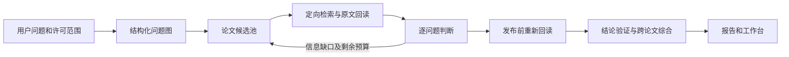

# 研究代理架构

单个 LangGraph 负责规划、检索、证据判断和报告发布。FastAPI 负责鉴权与幂等创建，单 Worker 从 SQLite 恢复上一轮状态。旧数据自动采用 V1。新实验的各层可以由离线运行器单独启用。

研究任务的访问凭据只随请求传递。图中的来源读取均通过绑定账户、范围及索引代次的工具注册表。每条来源的字符定位、哈希和权利标记进入引用记录。阶段产物与 checkpoint 绑定同一用户和运行标识。版本选择、独立实验和生产审批分开处理。

[问题与证据协议](QUESTION_AND_EVIDENCE_SCHEMA.md) · [上下文与预算](DECISION_AND_CONTEXT_CONTRACT.md) · [实验结果](EXPERIMENT_RESULTS.md)
