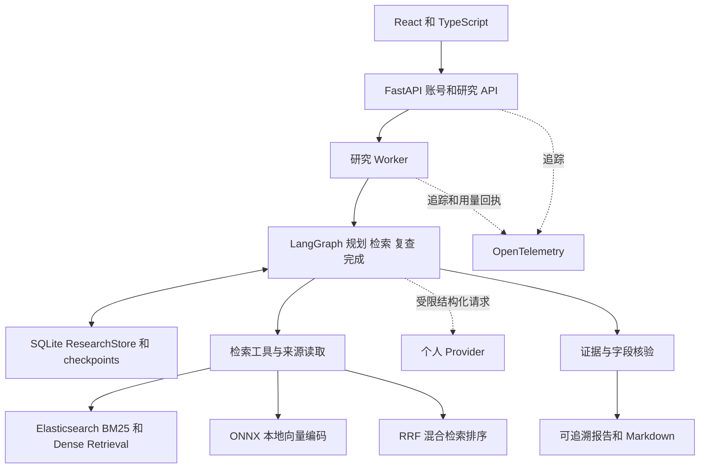

# ScholarLens EvoResearch 技术交接

## 基线与接管入口

2026-11-24 核对时，工作区位于 `codex/final-delivery`，未提交修改为零。工程成果以 `e5bda5f33bb52bcd3c15cc1bf37efb4791423ef4` 为基线。交接分支继承这个提交。选取后续基线时，先检查新提交是否包含这两个 PR 的预期文件树，再在同一语料、题库和预算下重建 A/G 对照。遇到 squash merge 时检查实际差异和验收结果。

| 引用 | 核对到的 SHA | 状态 |
|---|---|---|
| origin/main | `65fe6ba3dd0d09aa4f71abeff320d29b9e25fa19` | 默认分支 |
| origin/zjl | `fd4927c861ebbe86a3720c4d49917257182c39c9` | #42 目标 |
| [PRA #42](https://github.com/taoduo0428/scholarlens-ir/pull/42) | `67088d028cb9b533011e14faee2c0ead75bd7a47` | OPEN，目标 `zjl` |
| [工程 #43](https://github.com/taoduo0428/scholarlens-ir/pull/43) | `e5bda5f33bb52bcd3c15cc1bf37efb4791423ef4` | OPEN，草稿，目标 `codex/pra-research-reasoning` |

研究环境启用 `SCHOLARLENS_E11_ENABLED=true` 后使用 E11，`SCHOLARLENS_PRA_ARM` 默认为 A，G 为显式实验候选。无研究策略开关时 API 回退配置默认 V1，Compose 的 E11 开关也默认为 false。提交任务时记录实际策略与实验组。最新完整工程验收为 985 个后端测试、47 个前端测试，退出码均为 0。Windows 使用真实 Elasticsearch 8.19.23 和 859 篇论文、49,420 个向量的隔离副本。Linux CI 使用真实服务和 mock 数据核验 Elasticsearch 8.19.23 → 8.19.26 原卷升级。真实 Provider、外部遥测与实际账单待验。见[测试结果](../final/TEST_RESULTS.md)、[工程报告](../final/ENGINEERING_COMPLETION_REPORT.md)、[发布判定](../final/RELEASE_READINESS.md)与[最终 CI](https://github.com/taoduo0428/scholarlens-ir/actions/runs/45352771046)。

## 项目与架构

服务面向需要找论文、读原文、比较方法与实验、保存可复查报告的研究者。普通 RAG 通常执行检索和生成。ScholarLens 按问题和论文拆分证据义务，保存工具轨迹，允许逐字段答复，并在发布前逐项检查论文范围、引文、归属与推导。实际使用路径为登录、检索、选论文或工作区、提交研究问题、查看报告和原文位置、导出。

FastAPI 承担认证和任务接口，React 走同源 API。SQLite 保存账号、任务、检查点和报告制品，Elasticsearch 保存论文与向量索引。BM25 提供词匹配，Dense Retrieval 计算语义近邻，RRF 合并名次。ONNX 在现有 CPU 路径提供向量编码，RoBERTa 抽取式阅读属于单独实验。Docker Compose 管理应用和搜索服务，OpenTelemetry 连通 API 与 Worker 追踪，用量回执由研究存储保留。工程接管沿用这些组件、API 契约和账号隔离。见[架构](../specs/02_ARCHITECTURE.md)、[API](../specs/04_API_CONTRACT.md)、[部署](../final/DEPLOYMENT_ACCEPTANCE.md)。

## 执行链和权限

LangGraph 实际节点为 `plan → retrieve → critique → finish`，检索和复查可循环。下表中的 API、档案、关系、缺口、编译和核验是执行阶段或模块。配置上限见 `schemas.Budget`。E11 personal model API 最多 4 次模型调用，证据模式为 0。通用 E11 Budget 默认 4 轮、30 工具、30 证据、600 秒。诊断回放介质与预算见复现手册。Graph 的 recursion limit 为 32，与任务工具预算分别限制。

| 阶段 | 输入、转移和输出 |
|---|---|
| Research Goal → Intent | API 校验 owner、范围、幂等键与语料版本，创建任务。 `research_intent.research_intent` 提取比较对象、问题类型和所求字段。 |
| Question DAG | `questions.contract_for/make_plan` 建合约、节点、依赖与轮次。模型可提出结构化计划，`bind` 限制范围和目标，失败走确定性 `fallback`。 `node_fields.compile_fields` 将计划转成逐篇字段和前提义务。 |
| Retrieval → Source Reading | `ResearchGraph._action/_retrieve/_tool` 根据状态、覆盖、剩余预算和登记工具选择检索、读取或停止，模型建议须经过校验。 `_record_evidence` 保存论文 ID、语料版本、Evidence ID、定位与校验信息。 |
| Paper Research Profile | `profiles` 对来源原句按作者归属、字段、对象建档，保留出处与哈希。结构化摘要、短摘要补读与授权正文案例经回归。 |
| Evidence Graph → Pairwise | `source_graph/shared_relations` 建立可回读的来源前提和关系；验证同一对象、作者动作、适用范围、实验条件和反证。逐篇事实可独立保留；全组结论需覆盖用户指定的论文。 |
| Evidence Gap Controller | `ranked_gaps/next_gap` 用字段缺口选择补读及去重，受工具、轮次、时限与来源能力限制；无法补足时记录缺口。 |
| Answer Compiler | `compile_path/compile_answer` 使用已接受的字段绑定、Claim 和 Source 构造回答路径与报告段落，排序建议只能引用传入的服务端 ID。 |
| Evidence Verification → Publication Gate | `verify_claim` 核验来源和支持。 `evaluate_with_profiles` 检查字段响应、依赖、冲突和能力，`publish_fields` 固化直接回答与缺证状态；报告和导出沿用来源复查。 |
| Research Report | `_finish` 在编译后保存制品与核验结果，返回部分回答或明确缺证及位置。模型无发布权。暂停、取消、超时或预算耗尽按状态处理，未完成内容依照已有发布边界。 |

`ResearchStore` 按 owner 访问，记录 revision、事件、调用预算、检查点、制品和 usage，LangGraph 另有 SQLite checkpoint。模型超时或结构错误进入确定性回退，分析与综合最多消耗到预留编译的一秒前。恢复须沿用原语料代次、计划、ID 和所有权。

## 代码导航

以下路径以仓库根为基准。对每一处问题先找实际证据和可复现用例。

| 模块 | 接口与上下游 | 现有约束、失败风险及验证 |
|---|---|---|
| `backend/research/graph.py` | `ResearchGraph.run/_plan/_retrieve/_critique/_finish` 将任务、工具、校验和报告串联 | 保持硬预算、控制和 revision，重试可能重复消耗。查 `test_budget_enforcement.py`、`test_workspace_recovery.py`。 |
| `backend/research/questions.py` | `ResearchTaskContract`、`QuestionPlan`、`bind/revise` 接意图和模型计划，下发 DAG | 规划错可把结果比较变成方法背景。约束范围和前提。查 `test_questions.py`。 |
| `backend/research/research_intent.py` | `research_intent/plan_intent` 将原题变成类型和对象，供规划和字段构造 | 对象、趋势、指标、比较类型易混淆。查 `test_question_alignment.py`。 |
| `backend/research/node_fields.py` | `dimensions/compile_fields` 接计划和合约，下发字段和依赖 | 系统字段可能遗漏复合原题要求。查 `test_question_alignment.py`、`test_workspace_proof.py`。 |
| `backend/research/research_profile.py` | `PaperResearchProfile/ProfileItem/profiles/attribution/responsive_claims` 接来源及有界提名，交 Gate 与 Overview | 归属与相关性是常见首阻断。相邻句归属需要位置回查，避免把前人做法算给作者。查 `test_e10_profiles.py`、`test_pra_compilation.py`。 |
| `backend/research/workspace_model.py` | `semantic_call/reserve/publication_suggestions/synthesis_order` 通过 Provider 取标签与排序 | 请求内容有上限，陈述与证据须确实出现在输入中；失败回退，保留编译时间。查 `test_workspace_model.py`。 |
| `backend/research/provider_adapter.py` | `plan_questions/choose_action/_structured` 通过受限个人模型传输与 Schema 校验 | 服务端依然决策。JSON 方言或超时会回退。查 `test_workspace_model.py` 和 live runner。 |
| `backend/research/overview.py` | `synthesize/evidence_for` 聚合逐篇来源、字段和关系 | 逐篇列举与全组关系分开。查 `test_e11_overview_relations.py`。 |
| `backend/research/overview_relations.py` | `method_relations/finding_relations` 从已归属原句产生关系 | 提及方法的否定或未来工作都需识别。查 `test_e11_overview_relations.py`。 |
| `backend/research/evidence_graph.py` | 组织字段、来源与推导前提，供关系和报告回读 | 图结构有助审计，独立消融无答题增益。查 `test_pra_compilation.py`。 |
| `backend/research/pra_relations.py` | `source_graph/shared_relations/verify_derivation/connected_method_relations` 连接经核验的论文证据 | 子集关系、量纲冲突、跨论文中间项缺失均影响全组发布。查 `test_workspace_relations.py`。 |
| `backend/research/pra_gaps.py` | `ranked_gaps/next_gap` 把未满足字段变成补查优先级 | 仅对可恢复且在预算内的缺口行动。查 `test_pra_compilation.py`、`test_workspace_recovery.py`。 |
| `backend/research/answer_compiler.py` | `compile_path/compile_answer/markdown` 接字段绑定和 Claim 构造可显示结果 | 重排不能把比较前提变成结论。查 `test_pra_compilation.py`。 |
| `backend/research/claim_verifier.py` | `new_claim/verify_claim/compare_metrics` 回读直接主张及比较条件 | Source Claim 核验原句和归属，Derived Claim 核验全部前提及其关系。查 `test_claim_report.py`。 |
| `backend/research/field_gate.py` | `matches/qualified/evaluate_with_profiles` 映射可核验陈述到原始字段，输出状态与首阻断 | 受证据能力、依赖、冲突和题意限定。查 `test_workspace_proof.py`、`test_workspace_failure_analysis.py`。 |
| `backend/research/field_publication.py` | `publish_fields/markdown` 根据核验结果发出直接回答、依据、缺口 | 对缺证前提保持状态，输出边界变化会影响用户和导出。查 `test_claim_report.py`、`test_pra_compilation.py`。 |
| `backend/research/store.py` | `create/save/checkpoint/put_artifact/record_usage/backup/restore` 服务 API 与 Worker | 保护 owner、版本、幂等与恢复一致性。查 `test_store.py`、`test_workspace_recovery.py`。 |

研究专项测试位于 [backend/tests/research](../../backend/tests/research)，更细约束见 [PRA 架构](../agent-v8/PRA_ARCHITECTURE.md)。

## 演进与实验结论

V1 提供基础检索回放，V5 增加工作流和证据评价的成套入口，E9/E9.1 展开配对检索与阅读对照，E10 使用字段定位和可答性核验，E11 加强题意及原句归属并以逐篇证据组织综述。比较不同轮次时锁定相同题目。E11 历史记录 5/70、9/70、12/70 到本轮重放 15/70，分别属于不同修订。详见 [V6 结项](../agent-v6/FINAL_CLOSURE_REPORT.md)、[E11 质量](../agent-v7/RESEARCH_QUALITY_REPORT.md)。

| E11 消融组 | 改动 | 至少答一项 / 70 | 工具总数 |
|---|---|---:|---:|
| A | E11 | 15 | 994 |
| B | Paper Profile | 19 | 994 |
| C | Evidence Graph | 15 | 994 |
| D | Pairwise Reasoning | 15 | 994 |
| E | Gap Controller | 15 | 990 |
| F | Answer Compiler | 15 | 994 |
| G | 全部模块 | 20 | 991 |

A/G 新增 5 道部分或直接答题，原题全部要求均为 0/70。内部 41 道负例均无误发。系统自拆字段全满足为 1/70，原始 Silver 题目复核独立计数。历史全组综合 1/28，独立全文留出 0/12。PRA 的 27 条直接原句均经来源回读。Silver 是 AI 标注，209 个原题要求由单次 AI 事后复核，人工 Gold 为零。QASPER 采用公开人工参考，第一批盲测 G 误发 1/8，修复后同题 0/8；第二批盲测 A/G 均 1/8，同题 G 复测 0/8；独立第三批 A/G 都 1/24、0/8。内部 0/41 不外推到外部。累计收益主要来自 B，独立综合和问答未证实稳定收益，发布 Gate 维持 E11 默认。详见[消融](../agent-v8/ABLATION_REPORT.md)、[结项](../agent-v8/FINAL_ENGINEERING_REPORT.md)、[机器验收表](../agent-v8/PRA_SCORECARD.json)。

## 失败模式与后续研究顺序

- 先区分原文未读、读入未抽取、归属或相关性不明、依赖与绑定失败、真正不可比。G 中 50 道无直接回答的正例，其可见字段首阻断包括归属/相关性 170、读取 7、提取 3、绑定 3。首阻断是观测，逐题根因需要回读和最小对照。
- 结构化 Methods 专项的逐篇原句 0/10 → 10/10，双篇齐全 0/5 → 5/5，样本参与调试。保留明确作者动作与相邻指代规则。后续重点用新论文区分作者采用、背景、假设和未来工作。
- 同一全文留出读到更多正文，直接原句 43 → 50，全组仍 0/12。补读控制降低重复调用，无法补出未明示的比较条件。仅在同一最低证据标准下测试字段覆盖与等价关系。描述性并列可保留逐篇结果，效果优劣需要可比较条件。
- 普通方法关系、同条件度量、三跳前提和比较前提已实装。开发样例出现定向收益，独立全组仍为零。研究领域术语和动态关系前提时加入撤回任一论文证据、冲突及漏读对照。
- QASPER 的读到人工段落与发布完整参考答案分开评分。旧版误把 CCKS2019 结果比较规划成方法介绍，修复后工作流要求比较条件。全读原文时仍可卡在句级字段、作者归属或 Gate，需核对确切 Evidence ID 和输入窗口后才归因。
- 抽取式 ONNX Reader 在第一批 24 道可答题提名 12 道，只有 1 道完整命中单段参考答案，8 道负例提名 3 道。试验保留在本地评估，适合研究候选定位，发布仍依赖后端核验。
- 外部独立验证器可回读每条原句，V7 复查 16 条直接陈述未增加答题。对照阅读窗口的改动让完整可见对数从 99/142 → 142/142，证明输入视图修复，真实供应商语义能力待测。
- 重排与补读继续复用现有检索。E11/PRA 的诊断记录显示检索窗口命中可以与字段拒答并存。优先量化阶段损失和候选字段质量，再比较同预算排序；当前没有可单独引用的全局重排收益。
- 受控 HTTP 四阶段各有回执，生产供应商运行缺配置。区分 transport、JSON Schema、phase budget、source window 与语义质量。见[逐题失败索引](FAILURE_CASE_INDEX.md)及[模型验收手册](EXPERIMENT_REPRODUCIBILITY.md)。

从一个有据且未发布的字段入手，构造最小复现，再跑 A/G 配对、负例和独立 Holdout。衡量题级完整度、字段级完整度、逐题误发、来源核验、用量和延迟。先保持账户、权限、SQLite 架构、Docker、CI、前端结构和冻结数据协议的稳定。确需改变时附实验依据、兼容性与迁移成本。参见[复现手册](EXPERIMENT_REPRODUCIBILITY.md)、[实验清单](EXPERIMENT_MANIFEST.json)和[启动提示词](GEMINI_START_PROMPT.md)。
